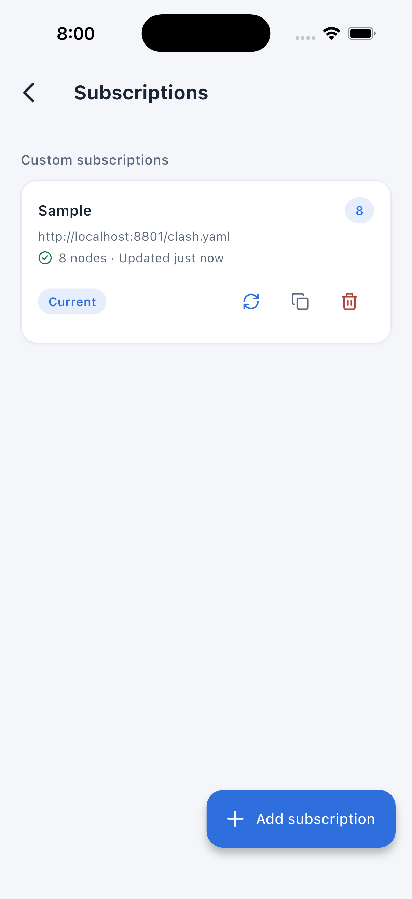

# ClashNova Mobile

Maintained by [clashnova-dev](https://github.com/clashnova-dev).

English · [简体中文](docs/i18n/README.zh-CN.md) · [Deutsch](docs/i18n/README.de.md) · [Français](docs/i18n/README.fr.md) · [日本語](docs/i18n/README.ja.md) · [한국어](docs/i18n/README.ko.md) · [Русский](docs/i18n/README.ru.md)

An iOS and Android proxy client built on [sing-box](https://sing-box.sagernet.org/) (libbox), written in Flutter. Import a Clash, sing-box, or universal subscription and you're connected — nothing runs on a server. Parsing, latency tests, and the connection itself all happen on the device.

The core comes from the [`sing_box`](https://pub.dev/packages/sing_box) plugin (GPL-3.0), so the project as a whole is released under **GPL-3.0**.

<p align="center">
  
  
  
</p>

## Features

**Subscriptions.** Three formats are parsed into nodes on the device:

- **Clash** YAML (`proxies:`) — converted in-app, covering ss / vmess / vless / trojan / hysteria2 / tuic / socks / http, the ws and grpc transports, and tls / reality / utls.
- **sing-box** JSON — its `outbounds` and `endpoints` are used directly.
- **Universal** — base64 or line-separated share links (vmess, vless, trojan, ss, hysteria2, tuic, and so on).

Each subscription can be refreshed, copied, or deleted; the card shows the node count and last-updated time, and any node type that can't be recognized is skipped without affecting the rest.

**Nodes.** Search by name, region, or protocol and sort by latency. *Test* runs a TCP handshake against every node — with a progress indicator you can interrupt — and grades the result green (≤100 ms), yellow (≤300 ms), or red, with *Timeout* for anything unreachable. Choose a node by hand, or leave it on automatic selection (the core's `urltest` group picks the fastest).

**Connection and routing.** The system VPN runs through a Network Extension (Packet Tunnel) on iOS and `VpnService` on Android. Switch routing between **rule**, **global**, and **direct** while connected (wired to the core's clash mode). A live connections list (each one closable), the core's live log, and up/down speed are all available.

**Interface.** Light / dark / follow-system themes, and seven languages — Simplified Chinese, English, 日本語, 한국어, Deutsch, Français, Русский — switched in Settings and applied immediately.

## Screenshots

| Nodes | Subscriptions | Settings | Help |
| :-: | :-: | :-: | :-: |
|  |  |  |  |

| Add subscription | Language | Home (light) | Home (dark) |
| :-: | :-: | :-: | :-: |
|  |  |  |  |

## Building

You'll need Flutter (the version is pinned by the `sdk` constraint in [pubspec.yaml](pubspec.yaml)) and the toolchain for each target platform.

```sh
cp .env.example .env
flutter pub get
python3 scripts/prepare-libbox.py android                                            # Go + Android SDK/NDK/JDK
python3 scripts/prepare-libbox.py apple                                              # macOS + Xcode (for iOS)
flutter run --dart-define-from-file=.env                                               # debug on a connected device
flutter build apk --release --dart-define-from-file=.env                               # Android
flutter build ipa --release --dart-define-from-file=.env --export-method development   # iOS
```

Build only the native platform(s) you need. Native source/dependency pins live in `native/`; the small `third_party/sing_box` binding fork accepts these locally rebuilt libraries and does not fall back to the older upstream binaries. Rebuild native libraries after changing pins. See [SECURITY.md](SECURITY.md) for the review scope.

### Configuration (.env)

Build options are injected with `--dart-define-from-file`, from a `.env` file in the project root (ignored by `.gitignore`):

```
ENABLE_LOGIN=false   # when false, the account login screen is hidden
BASE_URL=            # optional backend URL; leave empty to run as a standalone subscription client
GITHUB_URL=          # About page: project repository link; empty hides the row
```

Left at these defaults, the app is a self-contained subscription client. The defaults live in [lib/env.dart](lib/env.dart).

### iOS

The iOS VPN is provided by a Network Extension, so it **runs only on a real device** (the simulator runs the UI alone). A first build to a device needs:

- a paid Apple Developer account;
- signing configured for both the `Runner` and `PacketTunnel` targets in Xcode's *Signing & Capabilities*, with App Groups and Network Extensions enabled;
- the App Group `group.dev.airport.airportMobile` and the extension bundle id `dev.airport.airportMobile.PacketTunnel` (see [lib/core/sing_box_core.dart](lib/core/sing_box_core.dart)).
- Keychain Sharing for the app's own access group (declared in `Runner.entitlements`); the app's saved subscription credentials use device-only Keychain storage.

On the first connection, iOS asks to add the VPN configuration — allow it.

### Android

Use `flutter run -d <device>` for development. Release builds use `android/key.properties` (`storeFile`, `storePassword`, `keyAlias`, `keyPassword`) when supplied. Without a private release key they remain unsigned for local build validation; they never silently use the debug signing key. Sign with your release/upload key before distributing or installing a release APK. Signing files are git-ignored. The first connection triggers the system VPN authorization prompt; allow it.

Production API/subscription requests require HTTPS. Debug builds allow HTTP only for explicit loopback/Android-emulator addresses; a remote HTTP backend must be upgraded to HTTPS.

## Project layout

```
lib/
  main.dart            startup, MaterialApp, theme and locale, the login gate
  app_state.dart       state hub (subscriptions / nodes / connection / latency / routing mode / persistence)
  env.dart             build-time config (ENABLE_LOGIN / BASE_URL)
  i18n.dart, i18n/     message catalogs
  theme.dart           light and dark design tokens
  widgets.dart         shared widgets (cards, dialogs, dropdowns, pills, ...)
  core/
    sing_box_core.dart         sing_box plugin wrapper (connect / state / log / latency / clash mode)
    subscription_parser.dart   Clash / sing-box / universal parsing
  pages/               the individual pages (home / nodes / subscriptions / connections / logs / settings / help / login)
```

Outbound traffic is forwarded by the on-device sing-box core. The node test is a direct TCP handshake — it reflects server reachability and latency, not full throughput through the proxy.

## License

GPL-3.0. The project links sing-box (libbox), which is GPL-3.0, so distributions must follow the same license and make the corresponding source and notices available. See [LICENSE](LICENSE).

## Android releases and updates

Download signed APKs from [GitHub Releases](https://github.com/clashnova-dev/ClashNova-Mobile/releases). Settings → Check for updates reads this repository’s latest published release and opens its official download page. Android verifies the persistent release certificate when installing an update.

The Android packages workflow runs the Flutter test suite, compiles the pinned libbox source, builds a signed APK, and checks the package name, version, release certificate and launcher icon. Release signing material is stored in GitHub Actions secrets and is never committed. iOS is not packaged by this workflow.
