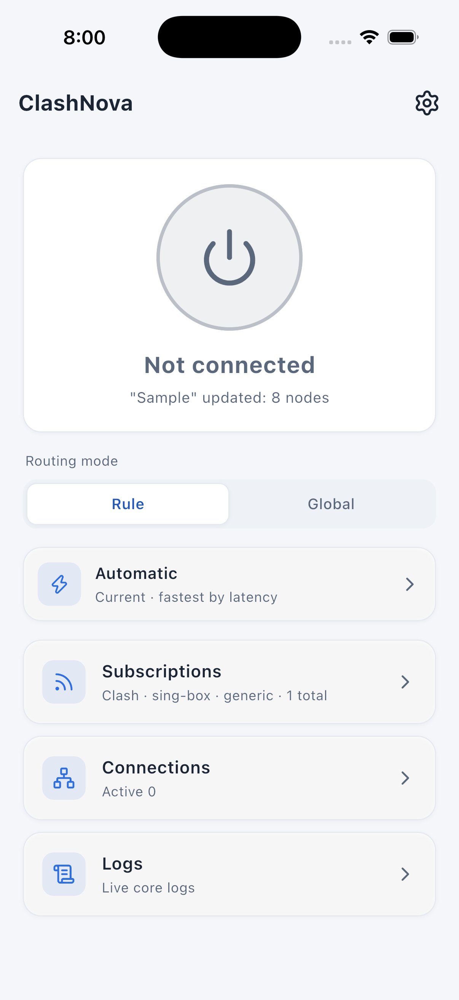
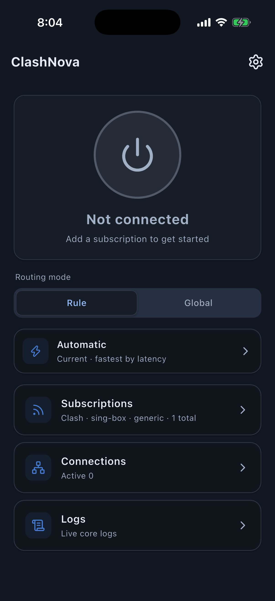

<div align="center">


<h1>ClashNova Mobile</h1>

<p>
  <b>Ein iOS- und Android-Proxy-Client auf Basis von <a href="https://sing-box.sagernet.org/">sing-box</a> (libbox), in Flutter geschrieben.</b><br/>
  Clash-, sing-box- oder universelles Abonnement importieren und verbunden sein – nichts läuft auf einem Server.
</p>

<p>
  <a href="../../LICENSE"></a>
  
  
  
  <a href="https://x.com/ClashNova2048"></a>
</p>

<p>
  <a href="../../README.md">English</a> ·
  <a href="README.zh-CN.md">简体中文</a> ·
  <b>Deutsch</b> ·
  <a href="README.fr.md">Français</a> ·
  <a href="README.ja.md">日本語</a> ·
  <a href="README.ko.md">한국어</a> ·
  <a href="README.ru.md">Русский</a>
</p>





</div>

> Übersetzungen können dem englischen Hauptdokument hinterherhinken.
## ✨ Funktionen

**Abonnements.** Drei Formate werden auf dem Gerät zu Knoten geparst:

- **Clash**-YAML (`proxies:`) – in der App konvertiert, deckt ss / vmess / vless / trojan / hysteria2 / tuic / socks / http ab, die ws- und grpc-Transporte sowie tls / reality / utls.
- **sing-box**-JSON – dessen `outbounds` und `endpoints` werden direkt verwendet.
- **Universell** – base64- oder zeilenweise Share-Links (vmess, vless, trojan, ss, hysteria2, tuic usw.).

Jedes Abonnement lässt sich aktualisieren, kopieren oder löschen; die Karte zeigt die Knotenzahl und den Zeitpunkt der letzten Aktualisierung, und jeder nicht erkennbare Knotentyp wird übersprungen, ohne die übrigen zu beeinträchtigen.

**Knoten.** Suche nach Name, Region oder Protokoll und Sortierung nach Latenz. *Test* führt gegen jeden Knoten einen TCP-Handshake aus – mit einer unterbrechbaren Fortschrittsanzeige – und bewertet das Ergebnis grün (≤100 ms), gelb (≤300 ms) oder rot, mit *Timeout* für alles Unerreichbare. Knoten von Hand wählen oder der automatischen Auswahl überlassen (die `urltest`-Gruppe des Kernels wählt den schnellsten).

**Verbindung und Routing.** Das System-VPN läuft unter iOS über eine Network Extension (Packet Tunnel) und unter Android über `VpnService`. Wechsle das Routing im verbundenen Zustand zwischen **Regel**, **Global** und **Direkt** (an den clash mode des Kernels gekoppelt). Eine Live-Liste der Verbindungen (jede schließbar), das Live-Log des Kernels und die Up-/Download-Geschwindigkeit stehen bereit.

**Oberfläche.** Helles / dunkles / systemabhängiges Design und sieben Sprachen – Vereinfachtes Chinesisch, Englisch, 日本語, 한국어, Deutsch, Français, Русский –, in den Einstellungen umschaltbar und sofort wirksam.

## 📸 Screenshots

| Knoten | Abonnements | Einstellungen | Hilfe |
| :-: | :-: | :-: | :-: |
|  |  |  |  |

| Abonnement hinzufügen | Sprache | Startseite (hell) | Startseite (dunkel) |
| :-: | :-: | :-: | :-: |
|  |  |  |  |

## 🛠️ Erstellen

Du brauchst Flutter (die Version ist durch die `sdk`-Einschränkung in [pubspec.yaml](../../pubspec.yaml) festgelegt) und die Toolchain für jede Zielplattform.

```sh
flutter pub get
python3 scripts/prepare-libbox.py android
python3 scripts/prepare-libbox.py apple
flutter run --dart-define-from-file=.env                                               # Debuggen auf einem angeschlossenen Gerät
flutter build apk --release --dart-define-from-file=.env                               # Android
flutter build ipa --release --dart-define-from-file=.env --export-method development   # iOS
```

### Konfiguration (.env)

Build-Optionen werden mit `--dart-define-from-file` aus einer `.env`-Datei im Projektwurzelverzeichnis eingespeist (von `.gitignore` ignoriert):

```
ENABLE_LOGIN=false   # bei false wird die Kontoanmeldung ausgeblendet
BASE_URL=            # optionale Backend-Adresse; leer = eigenständiger Abonnement-Client
```

Bei diesen Standardwerten ist die App ein eigenständiger Abonnement-Client. Die Standardwerte stehen in [lib/env.dart](../../lib/env.dart).

### iOS

Das iOS-VPN wird von einer Network Extension bereitgestellt und **läuft daher nur auf einem echten Gerät** (der Simulator führt nur die Oberfläche aus). Ein erster Build auf ein Gerät braucht:

- ein kostenpflichtiges Apple-Entwicklerkonto;
- in Xcodes *Signing & Capabilities* eingerichtete Signierung für die beiden Targets `Runner` und `PacketTunnel`, mit aktivierten App Groups und Network Extensions;
- die App Group `group.dev.airport.airportMobile` und die Extension-Bundle-ID `dev.airport.airportMobile.PacketTunnel` (siehe [lib/core/sing_box_core.dart](../../lib/core/sing_box_core.dart)).

Bei der ersten Verbindung fragt iOS, ob die VPN-Konfiguration hinzugefügt werden soll – erlaube es.

### Android

Verwende `flutter run -d <Gerät>` oder installiere die Release-APK. Die erste Verbindung löst die System-VPN-Autorisierung aus; erlaube sie.

## 🗂️ Projektstruktur

```
lib/
  main.dart            Start, MaterialApp, Design und Sprache, die Login-Sperre
  app_state.dart       Status-Hub (Abonnements / Knoten / Verbindung / Latenz / Routing-Modus / Persistenz)
  env.dart             Konfiguration zur Build-Zeit (ENABLE_LOGIN / BASE_URL)
  i18n.dart, i18n/     Nachrichtenkataloge
  theme.dart           helle und dunkle Design-Tokens
  widgets.dart         gemeinsame Widgets (Karten, Dialoge, Dropdowns, Pills usw.)
  core/
    sing_box_core.dart         Wrapper für das sing_box-Plugin (Verbindung / Status / Log / Latenz / clash mode)
    subscription_parser.dart   Parsing von Clash / sing-box / universell
  pages/               die einzelnen Seiten (Start / Knoten / Abonnements / Verbindungen / Logs / Einstellungen / Hilfe / Login)
```

Der ausgehende Verkehr wird vom sing-box-Kernel auf dem Gerät weitergeleitet. Der Knotentest ist ein direkter TCP-Handshake – er spiegelt Erreichbarkeit und Latenz des Servers wider, nicht den vollen Durchsatz durch den Proxy.

## 📄 Lizenz

GPL-3.0. Das Projekt bindet sing-box (libbox) ein, das unter GPL-3.0 steht, daher müssen Distributionen derselben Lizenz folgen und den entsprechenden Quellcode samt Hinweisen bereitstellen. Siehe [LICENSE](../../LICENSE).
