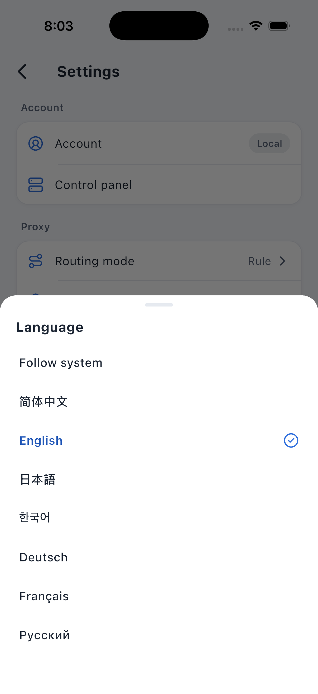

<div align="center">


<h1>ClashNova Mobile</h1>

<p>
  <b><a href="https://sing-box.sagernet.org/">sing-box</a>(libbox)をベースにした iOS / Android 向けプロキシクライアント。Flutter 製。</b><br/>
  Clash / sing-box / 汎用のサブスクリプションを取り込むだけで接続でき、サーバーは不要です。
</p>

<p>
  <a href="../../LICENSE"></a>
  
  
  
</p>

<p>
  <a href="../../README.md">English</a> ·
  <a href="README.zh-CN.md">简体中文</a> ·
  <a href="README.de.md">Deutsch</a> ·
  <a href="README.fr.md">Français</a> ·
  <b>日本語</b> ·
  <a href="README.ko.md">한국어</a> ·
  <a href="README.ru.md">Русский</a>
</p>


<p><a href="https://github.com/clashnova-dev">clashnova-dev</a></p>

</div>

> 翻訳は英語の主ドキュメントより古い場合があります。
## ✨ 機能

**サブスクリプション。** 3 種類の形式が端末上でノードに解析されます。

- **Clash** YAML(`proxies:`)——アプリ内で変換し、ss / vmess / vless / trojan / hysteria2 / tuic / socks / http、ws・grpc トランスポート、tls / reality / utls に対応。
- **sing-box** JSON——その `outbounds` と `endpoints` をそのまま使用。
- **汎用**——base64 または 1 行ずつの共有リンク(vmess、vless、trojan、ss、hysteria2、tuic など)。

各サブスクリプションは更新・コピー・削除でき、カードにはノード数と最終更新時刻が表示されます。認識できないノードタイプはスキップされ、ほかのノードには影響しません。

**ノード。** 名前・地域・プロトコルで検索し、遅延で並べ替えます。「テスト」は各ノードに対して TCP ハンドシェイクを実行し——中断できる進捗表示付き——結果を緑(≤100 ms)・黄(≤300 ms)・赤に分類し、到達できないものは「タイムアウト」と表示します。手動でノードを選ぶか、自動選択に任せます(コアの urltest グループが最速を選びます)。

**接続とルーティング。** システム VPN は iOS では Network Extension(Packet Tunnel)、Android では VpnService を通して動作します。接続中に **ルール**・**グローバル**・**ダイレクト** のルーティングを切り替えられます(コアの clash mode に連動)。リアルタイムの接続一覧(各接続を個別に切断可能)、コアのリアルタイムログ、上り下り速度がそろっています。

**インターフェイス。** ライト / ダーク / システム追従テーマと、7 言語——簡体字中国語、English、日本語、한국어、Deutsch、Français、Русский——を設定で切り替え、即座に反映します。

## 📸 スクリーンショット

| ノード | サブスクリプション | 設定 | ヘルプ |
| :-: | :-: | :-: | :-: |
|  |  |  |  |

| サブスクリプション追加 | 言語 | ホーム(ライト) | ホーム(ダーク) |
| :-: | :-: | :-: | :-: |
|  |  |  |  |

## 🛠️ ビルド

Flutter(バージョンは [pubspec.yaml](../../pubspec.yaml) の `sdk` 制約に従う)と各ターゲットプラットフォームのツールチェーンが必要です。

```sh
cp .env.example .env
flutter pub get
python3 scripts/prepare-libbox.py android
python3 scripts/prepare-libbox.py apple
flutter run --dart-define-from-file=.env                                               # 接続した端末でデバッグ
flutter build apk --release --dart-define-from-file=.env                               # Android
flutter build ipa --release --dart-define-from-file=.env --export-method development   # iOS
```

### 設定(.env)

ビルドオプションは `--dart-define-from-file` でプロジェクト直下の `.env` ファイル(`.gitignore` で無視)から注入されます。

```
ENABLE_LOGIN=false   # false のときはアカウントログイン画面を非表示にする
BASE_URL=            # 任意のバックエンドアドレス。空にすると単体のサブスクリプションクライアントとして動作
```

デフォルトのままなら、アプリは自己完結したサブスクリプションクライアントです。デフォルト値は [lib/env.dart](../../lib/env.dart) にあります。

### iOS

iOS の VPN は Network Extension が提供するため、**実機でのみ動作します**(シミュレーターは UI のみ)。実機への初回ビルドには次が必要です。

- 有料の Apple 開発者アカウント;
- Xcode の *Signing & Capabilities* で `Runner` と `PacketTunnel` の 2 つの target に署名を設定し、App Groups と Network Extensions を有効化;
- App Group `group.dev.airport.airportMobile` と拡張の bundle id `dev.airport.airportMobile.PacketTunnel`([lib/core/sing_box_core.dart](../../lib/core/sing_box_core.dart) を参照)。

初回接続時に iOS が VPN 構成の追加を求めるので、許可してください。

### Android

`flutter run -d <デバイス>` を使うか、release APK をインストールします。初回接続でシステムの VPN 認可ダイアログが表示されるので、許可してください。

## 🗂️ プロジェクト構成

```
lib/
  main.dart            起動、MaterialApp、テーマ・言語、ログインゲート
  app_state.dart       状態ハブ(サブスクリプション / ノード / 接続 / 遅延 / ルーティングモード / 永続化)
  env.dart             ビルド時の設定(ENABLE_LOGIN / BASE_URL)
  i18n.dart, i18n/     メッセージカタログ
  theme.dart           ライト・ダークのデザイントークン
  widgets.dart         再利用コンポーネント(カード、ダイアログ、ドロップダウン、pill など)
  core/
    sing_box_core.dart         sing_box プラグインのラッパー(接続 / 状態 / ログ / 遅延 / clash mode)
    subscription_parser.dart   Clash / sing-box / 汎用の解析
  pages/               各ページ(ホーム / ノード / サブスクリプション / 接続 / ログ / 設定 / ヘルプ / ログイン)
```

実際の送信トラフィックは端末上の sing-box コアが転送します。ノードテストは直接の TCP ハンドシェイクで——サーバーの到達性と遅延を反映し、プロキシ経由の完全なスループットではありません。

## 📄 ライセンス

GPL-3.0。本プロジェクトは GPL-3.0 の sing-box(libbox)をリンクしているため、配布時は同じライセンスに従い、対応するソースコードと表示を提供する必要があります。[LICENSE](../../LICENSE) を参照してください。
