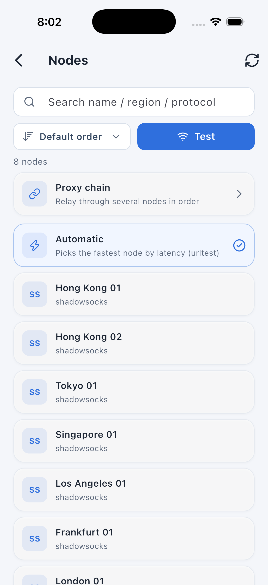
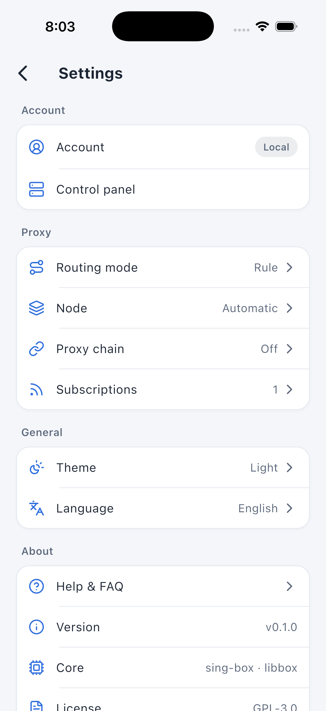
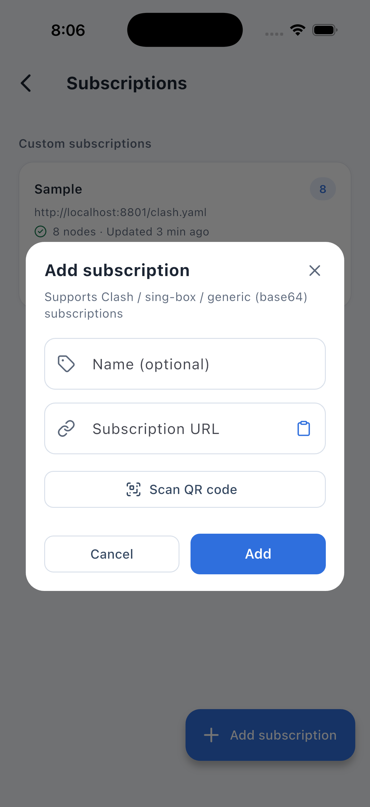

<div align="center">


<h1>ClashNova Mobile</h1>

<p>
  <b>Прокси-клиент для iOS и Android на основе <a href="https://sing-box.sagernet.org/">sing-box</a> (libbox), написан на Flutter.</b><br/>
  Импортируйте подписку Clash, sing-box или универсальную — на сервере ничего не выполняется.
</p>

<p>
  <a href="../../LICENSE"></a>
  
  
  
</p>

<p>
  <a href="../../README.md">English</a> ·
  <a href="README.zh-CN.md">简体中文</a> ·
  <a href="README.de.md">Deutsch</a> ·
  <a href="README.fr.md">Français</a> ·
  <a href="README.ja.md">日本語</a> ·
  <a href="README.ko.md">한국어</a> ·
  <b>Русский</b>
</p>




<p><a href="https://github.com/clashnova-dev">clashnova-dev</a></p>

</div>

> Переводы могут отставать от основного документа на английском.
## ✨ Возможности

**Подписки.** Три формата разбираются в узлы на устройстве:

- **Clash** YAML (`proxies:`) — преобразуется в приложении, охватывает ss / vmess / vless / trojan / hysteria2 / tuic / socks / http, транспорты ws и grpc, а также tls / reality / utls.
- **sing-box** JSON — его `outbounds` и `endpoints` используются напрямую.
- **Универсальный** — ссылки-share в base64 или построчно (vmess, vless, trojan, ss, hysteria2, tuic и т. д.).

Каждую подписку можно обновить, скопировать или удалить; на карточке показаны число узлов и время последнего обновления, а любой нераспознанный тип узла пропускается, не затрагивая остальные.

**Узлы.** Поиск по имени, региону или протоколу и сортировка по задержке. *Тест* выполняет TCP-рукопожатие с каждым узлом — с прерываемым индикатором прогресса — и оценивает результат зелёным (≤100 мс), жёлтым (≤300 мс) или красным, с пометкой *Тайм-аут* для недоступных. Выбирайте узел вручную или доверьте автоматическому выбору (группа urltest ядра выбирает самый быстрый).

**Соединение и маршрутизация.** Системный VPN работает через Network Extension (Packet Tunnel) на iOS и через VpnService на Android. Переключайте маршрутизацию между **по правилам**, **глобальной** и **прямой** в подключённом состоянии (связано с clash mode ядра). Доступны список активных соединений (каждое можно закрыть), живой журнал ядра и скорость приёма/передачи.

**Интерфейс.** Светлая / тёмная / системная темы и семь языков — упрощённый китайский, English, 日本語, 한국어, Deutsch, Français, Русский — переключаются в настройках и применяются сразу.

## 📸 Скриншоты

| Узлы | Подписки | Настройки | Справка |
| :-: | :-: | :-: | :-: |
|  |  |  |  |

| Добавить подписку | Язык | Главная (светлая) | Главная (тёмная) |
| :-: | :-: | :-: | :-: |
|  |  |  |  |

## 🛠️ Сборка

Понадобятся Flutter (версия задана ограничением `sdk` в [pubspec.yaml](../../pubspec.yaml)) и набор инструментов для каждой целевой платформы.

```sh
cp .env.example .env
flutter pub get
python3 scripts/prepare-libbox.py android
python3 scripts/prepare-libbox.py apple
flutter run --dart-define-from-file=.env                                               # отладка на подключённом устройстве
flutter build apk --release --dart-define-from-file=.env                               # Android
flutter build ipa --release --dart-define-from-file=.env --export-method development   # iOS
```

### Конфигурация (.env)

Параметры сборки передаются через `--dart-define-from-file` из файла `.env` в корне проекта (он в `.gitignore`):

```
ENABLE_LOGIN=false   # при false экран входа в аккаунт скрыт
BASE_URL=            # необязательный адрес бэкенда; пусто — автономный клиент подписок
```

При этих значениях по умолчанию приложение — самодостаточный клиент подписок. Значения по умолчанию находятся в [lib/env.dart](../../lib/env.dart).

### iOS

VPN на iOS предоставляет Network Extension, поэтому он **работает только на реальном устройстве** (симулятор запускает только интерфейс). Для первой сборки на устройство нужны:

- платный аккаунт разработчика Apple;
- настроенная подпись для обоих таргетов `Runner` и `PacketTunnel` в разделе *Signing & Capabilities* в Xcode, с включёнными App Groups и Network Extensions;
- App Group `group.dev.airport.airportMobile` и bundle id расширения `dev.airport.airportMobile.PacketTunnel` (см. [lib/core/sing_box_core.dart](../../lib/core/sing_box_core.dart)).

При первом подключении iOS попросит добавить конфигурацию VPN — разрешите это.

### Android

Используйте `flutter run -d <устройство>` или установите release-APK. Первое подключение вызывает системный запрос авторизации VPN; разрешите его.

## 🗂️ Структура проекта

```
lib/
  main.dart            запуск, MaterialApp, тема и язык, шлюз входа
  app_state.dart       центр состояния (подписки / узлы / соединение / задержка / режим маршрутизации / сохранение)
  env.dart             конфигурация времени сборки (ENABLE_LOGIN / BASE_URL)
  i18n.dart, i18n/     каталоги сообщений
  theme.dart           светлые и тёмные дизайн-токены
  widgets.dart         переиспользуемые компоненты (карточки, диалоги, выпадающие списки, pill и т. д.)
  core/
    sing_box_core.dart         обёртка плагина sing_box (соединение / состояние / журнал / задержка / clash mode)
    subscription_parser.dart   разбор Clash / sing-box / универсальный
  pages/               отдельные страницы (главная / узлы / подписки / соединения / журналы / настройки / справка / вход)
```

Фактический исходящий трафик пересылает ядро sing-box на устройстве. Тест узла — это прямое TCP-рукопожатие: он отражает доступность и задержку сервера, а не полную пропускную способность через прокси.

## 📄 Лицензия

GPL-3.0. Проект линкует sing-box (libbox) под GPL-3.0, поэтому дистрибутивы должны соблюдать ту же лицензию и предоставлять соответствующий исходный код и уведомления. См. [LICENSE](../../LICENSE).
