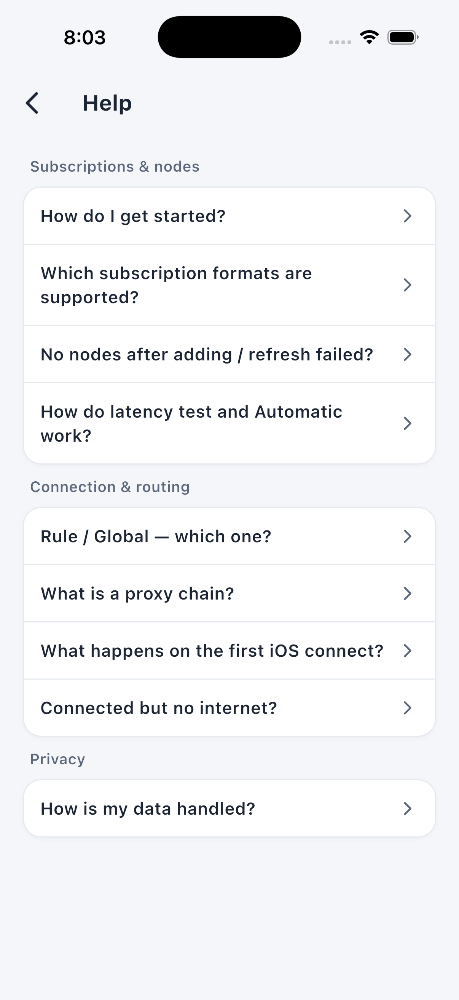

<div align="center">


<h1>ClashNova Mobile</h1>

<p>
  <b>基于 <a href="https://sing-box.sagernet.org/">sing-box</a>(libbox)的 iOS 与 Android 代理客户端,用 Flutter 编写。</b><br/>
  导入 Clash、sing-box 或通用订阅即可连接 —— 不依赖任何服务端。
</p>

<p>
  <a href="../../LICENSE"></a>
  
  
  
</p>

<p>
  <a href="../../README.md">English</a> ·
  <b>简体中文</b> ·
  <a href="README.de.md">Deutsch</a> ·
  <a href="README.fr.md">Français</a> ·
  <a href="README.ja.md">日本語</a> ·
  <a href="README.ko.md">한국어</a> ·
  <a href="README.ru.md">Русский</a>
</p>


<p><a href="https://github.com/clashnova-dev">clashnova-dev</a></p>

</div>

> 译文可能滞后于英文主文档。
## ✨ 功能

**订阅。** 三种格式都会在设备上解析成节点:

- **Clash** YAML(`proxies:`)——应用内转换,覆盖 ss / vmess / vless / trojan / hysteria2 / tuic / socks / http,以及 ws、grpc 传输与 tls / reality / utls。
- **sing-box** JSON——直接取其 `outbounds` 和 `endpoints`。
- **通用**——base64 或逐行的分享链接(vmess、vless、trojan、ss、hysteria2、tuic 等)。

每条订阅都能刷新、复制、删除;卡片显示节点数与更新时间,无法识别的节点类型会被跳过,不影响其余节点。

**节点。** 按名称、地区或协议搜索,并按延迟排序。「测速」对每个节点做一次 TCP 握手——带进度、可中断——结果按绿色(≤100 ms)、黄色(≤300 ms)、红色分级,连不上显示「超时」。可手动选节点,也可保持自动选择(内核的 urltest 分组挑最快的)。

**连接与路由。** 系统 VPN 在 iOS 上走 Network Extension(Packet Tunnel),在 Android 上走 VpnService。连接中可在**规则**、**全局**、**直连**间切换(接内核的 clash mode)。实时连接列表(每条可关闭)、内核实时日志、上下行速率一应俱全。

**界面。** 浅色 / 深色 / 跟随系统主题,以及七种语言——简体中文、English、日本語、한국어、Deutsch、Français、Русский——在设置里切换,即时生效。

## 📸 截图

| 节点 | 订阅 | 设置 | 帮助 |
| :-: | :-: | :-: | :-: |
|  |  |  |  |

| 添加订阅 | 语言 | 首页(浅色) | 首页(深色) |
| :-: | :-: | :-: | :-: |
|  |  |  |  |

## 🛠️ 构建

需要 Flutter(版本以 [pubspec.yaml](../../pubspec.yaml) 的 `sdk` 约束为准)和各目标平台的工具链。

```sh
cp .env.example .env
flutter pub get
python3 scripts/prepare-libbox.py android
python3 scripts/prepare-libbox.py apple
flutter run --dart-define-from-file=.env                                               # 连接设备调试
flutter build apk --release --dart-define-from-file=.env                               # Android
flutter build ipa --release --dart-define-from-file=.env --export-method development   # iOS
```

### 配置(.env)

构建选项通过 `--dart-define-from-file` 注入,来自项目根目录的 `.env` 文件(已被 `.gitignore` 忽略):

```
ENABLE_LOGIN=false   # 为 false 时隐藏账号登录界面
BASE_URL=            # 可选的后端地址;留空即作为独立订阅客户端运行
```

保持默认时,应用是一个自包含的订阅客户端。默认值见 [lib/env.dart](../../lib/env.dart)。

### iOS

iOS 的 VPN 由 Network Extension 提供,因此**只能在真机运行**(模拟器只跑界面)。首次构建到真机需要:

- 付费 Apple 开发者账号;
- 在 Xcode 的 *Signing & Capabilities* 中为 `Runner` 和 `PacketTunnel` 两个 target 配好签名,并开启 App Groups 与 Network Extensions;
- App Group 为 `group.dev.airport.airportMobile`,扩展 bundle id 为 `dev.airport.airportMobile.PacketTunnel`(见 [lib/core/sing_box_core.dart](../../lib/core/sing_box_core.dart))。

首次连接时,iOS 会弹窗请求添加 VPN 配置,允许即可。

### Android

使用 `flutter run -d <设备>` 或安装 release APK。首次连接会触发系统 VPN 授权弹窗,允许即可。

## 🗂️ 项目结构

```
lib/
  main.dart            启动、MaterialApp、主题与语言、登录门禁
  app_state.dart       状态中枢(订阅 / 节点 / 连接 / 测速 / 路由模式 / 持久化)
  env.dart             构建期配置(ENABLE_LOGIN / BASE_URL)
  i18n.dart, i18n/     多语言消息表
  theme.dart           明暗两套设计令牌
  widgets.dart         复用组件(卡片、弹窗、下拉、pill 等)
  core/
    sing_box_core.dart         sing_box 插件封装(连接 / 状态 / 日志 / 测速 / clash mode)
    subscription_parser.dart   Clash / sing-box / 通用订阅解析
  pages/               各页面(首页 / 节点 / 订阅 / 连接 / 日志 / 设置 / 帮助 / 登录)
```

实际出站流量由设备上的 sing-box 内核转发。节点测速是直连 TCP 握手——反映服务器可达性与延迟,不是走代理的完整吞吐。

## 📄 许可证

GPL-3.0。本项目链接了 GPL-3.0 的 sing-box(libbox),分发时须遵循同一许可证并提供相应源码与声明。见 [LICENSE](../../LICENSE)。
